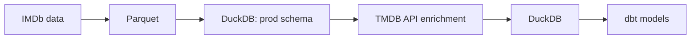

# Movies Analytics Pipeline (IMDb + TMDB)

An end-to-end data pipeline that combines IMDb's bulk historical movie datasets with
live enrichment from the TMDB API


## Overview

IMDb publishes free daily bulk datasets, metadata like overview, budget, revenue, etc. TMDB has a free API with that missing
metadata, but no historical bulk export. This pipeline joins the two:

IMDb's
datasets as the backbone for movie titles and ratings.

And TMDB enriches each title with posters, overviews,
cast, budget, revenue, etc.

## Flow




## Requirements

- [uv](installs Python and all dependencies from `pyproject.toml`)
- Docker (the IMDb download runs `curl` in a container)
- A TMDB API key

## Setup

Install the Python dependencies (including dbt and DuckDB) from `pyproject.toml`

```bash
uv sync
```
Set your TMDB API key as an environment variable before running the TMDB scripts:

```bash
export API_KEY=your_key_here
```

## Pipeline Stages

### 1. Ingest
IMDb's seven dataset files (`title.basics`, `title.ratings`, `title.crew`,
`title.episode`, `title.principals`, `title.akas`, `name.basics`) are
downloaded via a disposable Docker container 

### 2. Convert
Raw TSV files are parsed with DuckDB and written out as Parquet for faster querying


### 3. Load
Parquet files are loaded into a local DuckDB database (`movies_project.duckdb`)
under a `prod` schema.

### 4. Filter
Titles are filtered down from ~11M IMDb records to a manageable subset
(`titleType = 'movie' AND numVotes >= 5000`) before API enrichment.
TMDB can't be called for every title at this scale.

### 5. Enrich
For each filtered title, the TMDB `/find` endpoint resolves the IMDb ID to a
TMDB ID and pulls overview, cast, budget, and revenue. The fetch step is made to be resumable, concurrent and fault-tolerant.

### 6. Join & Serve
Enriched TMDB data is joined back to the IMDb tables on `imdb_id` for querying.


## Scripts (run in this order)

| Step | Script | What it does |
|---|---|---|
| 1 | `imdb_download_data.py` | Downloads the IMDb `.tsv.gz` datasets into `data/` |
| 2 | `imdb_ingest_data.py` | Converts the files to parquet and loads each one into DuckDB as a table in the `prod` schema |
| 3 | `tmdb_get_id.py` | Looks up the TMDB ID for each IMDb ID in `title_ratings` with (`numVotes => 5000`) via the TMDB `/find` endpoint (retries on failure and rate limits) |
| 4 | `tmdb_load_id.py` | Loads the IMDb → TMDB ID mapping into `prod.tmdb_ids` |
| 5 | `tmdb_get_details.py` | Fetches movie details for each TMDB ID using threads via the [tmdbsimple](https://github.com/celiao/tmdbsimple) wrapper. Writes to `tmdb_details.jsonl` as it goes, so it can resume after a crash. |
| 6 | `tmdb_load_details.py` | Loads the jsonl into `prod.tmdb_movie_details` and builds the full poster URL |

Output database: `movies_project.duckdb`.


## dbt

The models live in `movies_db/`. See [movies_db/README.md](movies_db/README.md).

## Data Sources
- [IMDb Non-Commercial Datasets](https://datasets.imdbws.com/) — personal/non-commercial use only
- [TMDB API](https://www.themoviedb.org/documentation/api) — this product uses the TMDB API but is not endorsed or certified by TMDB
